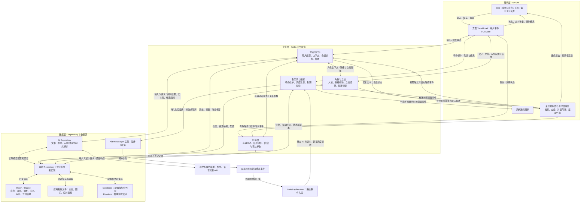

# 初期功能验证架构

## 已确定的范围

- 平台与语言：Android / Kotlin。
- 架构：展示层、业务层、数据层；页面采用 MVVM。
- 模型调用：用户配置自己的 API，通过客户端直连供应商。
- 数据：默认本地保存，初期采用一个 app 内的功能包划分。
- 交互：文字、图片、语音、桌宠触摸；主动授权采集单帧屏幕并复用图片附件链路。
- 角色：形象、性格、世界观、经历、情绪立绘。
- 成长：有效交互、有效陪伴时长、好感度与关系阶段。
- 备忘录：连续点击桌宠打开，维护不同时间的待办，到期显示提醒。

三层代码与 Android 构建已实现。当前单 app 模块内按功能分包，bootstrap 手工装配；不是独立服务器或微服务。验证结果以测试报告为准。

## 三层职责与依赖

| 位置 | 职责 | 划分原因 |
| --- | --- | --- |
| `presentation` | 页面、ViewModel、桌宠、气泡、通知、导航 | 将显示和生命周期问题集中处理，业务规则不操作 View |
| `business` | 组织对话、角色规则、好感度、记忆、待办与提醒 | 同一业务规则可供页面、桌宠和系统事件入口复用 |
| `data` | Repository、本地存储、API、闹钟与媒体适配 | 隔离数据库结构、供应商协议和安卓系统细节 |
| `model` | 角色、消息、关系、待办、情绪、资源引用等共享类型 | 使跨层交换的数据独立于 Room Entity、供应商 DTO 和安卓 UI 类型 |
| `bootstrap` | Application 入口、实例装配、系统广播入口 | 连接安卓生命周期与业务，集中管理跨层装配 |

常规代码调用方向为 `presentation → business → data`，三层均可引用 `model`。`data` 不反向引用页面或业务服务；`bootstrap` 负责创建实例并注入依赖。

仓库实现放在 `data/repository`，对外使用共享模型；数据库 Entity 和协议解析留在数据层内部。初期直接注入具体仓库，未增加只有一个实现的接口。页面的轻量 CRUD 可通过 ViewModel 直接读取仓库，业务决策仍集中在服务。后续确有第二种实现时再提取接口。

`bootstrap/receiver` 接收系统事件后调用业务服务。`data/platform/alarm` 负责注册、取消闹钟，使用入口装配的广播目标，避免数据层反向调用业务类。

## 整体运行时数据流

下图表示运行时的数据与事件流，不是代码的 import 方向。业务产生的结果由展示侧收集；箭头指向展示侧不表示业务层直接依赖 View 或悬浮窗服务。双向箭头表示请求与结果返回。

图中的“对话与记忆”和“本地 Repository”分别合并展示了多个职责；对应目录中仍按功能组织类，避免形成全能服务或全能 Repository。

## 关键业务数据流

### 对话与多模态输入

1. 页面或桌宠产生输入，业务层将其转换为统一的交互事件。
2. 对图片和语音，按供应商能力直接提交，或先完成视觉理解、语音识别。授权截图复用图片链路。
3. 读取角色设定、当前关系、相关记忆及最近消息，构建有长度预算的上下文。
4. 数据层将统一请求转换为供应商协议，使用用户凭证调用 API，解析文本增量与候选情绪。
5. 业务层维护消息状态并保存结果；页面和桌宠收集状态，显示文本与立绘。

文本、视觉、ASR 能力可以使用不同配置。接口支持情况需要逐一确认。取消、超时、鉴权失败、限流和流式中断属于会话状态的一部分，未完成消息应可识别。

### 好感度与记忆

1. 对话和桌宠产生可计分的事件，每个事件有唯一标识，避免重复计分。
2. 关系业务应用冷却、每日上限和有效时长规则，更新本地关系状态。
3. 后续对话将关系阶段转换为表达参数，并与角色固有性格一起进入上下文。
4. 记忆业务保存用户以“记住”明确指定的事实；上下文限制历史和事实数量。当前不调用模型做自动摘要，避免增加费用和等待。

分数与阶段由应用规则决定；模型根据这些状态调整表达。桌宠常驻时长与有效陪伴时长分开计算。

### 备忘录与定时提醒

1. `presentation/pet` 本地识别连续点击，由导航打开备忘录页。
2. ViewModel 提交待办标题和提醒时间，业务校验后先写入 Room。
3. 保存成功后通过 `data/platform/alarm` 注册闹钟；编辑、完成或删除待办时取消旧调度。
4. 到期广播进入 `bootstrap/receiver`，调用备忘录业务，重新读取待办并校验状态、时间和提醒版本。
5. 有效提醒转换为展示事件；桌宠可显示时弹气泡，否则走系统通知。两种展示由同一提醒结果选择，避免重复提醒。
6. 应用启动、设备重启后，根据数据库重建未完成提醒，修复持久化与系统调度之间的中断。

数据库是待办事实来源；闹钟只负责触发时间。记录提醒版本可以使旧回调失效。保存实际提醒时刻，并保留需要展示的时区信息；时区变化后重新核对调度。

提醒使用本地模板和待办文本即可完成。精确闹钟、通知、悬浮窗及后台运行需要按目标安卓版本处理权限和限制，气泡展示不依赖某个页面或其 ViewModel 存活。

### 情绪立绘

1. 用户在角色页选择图片并指定情绪，资源导入适配将图片复制到应用私有目录。
2. 数据库保存 `角色 ID + 情绪标识 → 资源 ID` 映射，文件适配负责实际路径和读取。
3. 同一次模型回复可通过约定字段提供候选情绪；业务层校验并查询当前角色的映射。
4. 展示侧收到稳定的资源引用后加载立绘；缺少情绪、解析失败或没有对应资源时使用默认立绘。

情绪标识需要提示词或结构化输出约定，不能假定供应商原生提供。模型只提供情绪标识，本地映射决定图片。更换默认立绘与对话情绪切换复用同一套资源选择规则。

## 源码资源与运行时数据

| 内容 | 保存位置 | 原因 |
| --- | --- | --- |
| 默认角色模板 | `model/Models.kt` 与 `presentation/pet/MascotArt.kt` | 设定和原生绘制随包分发；assets/characters 预留后续模板 |
| 内置占位图、字符串、主题 | `app/src/main/res` | 使用安卓资源系统 |
| 用户上传立绘与附件 | 运行时的应用私有文件目录，由 `data/local/files` 管理 | 用户数据可新增、替换、清理 |
| 角色、消息、关系、待办、立绘映射 | 运行时的 Room 数据库 | 统一查询与事务更新 |
| API 地址、模型与应用配置 | 运行时的 DataStore | 小型配置独立于关系数据 |
| 用户 API 凭证 | 加密后持久化，加密密钥由 Android Keystore 管理 | 由凭证适配统一处理读取和加解密 |

源码目录中的 `data/local/files` 和 `data/local/database` 存放管理代码，不存放用户文件或数据库实例。

## 初期实现顺序

1. 初始化安卓构建工程，跑通角色创建、文本对话、流式显示和本地保存。
2. 接入悬浮桌宠、触摸事件和默认立绘。
3. 接入情绪立绘映射、好感度和有限上下文记忆。
4. 完成备忘录、系统闹钟、气泡和通知提醒闭环。
5. 接入图片、语音及范围确认后的屏幕采集，进行目标设备的资源与响应验证。
